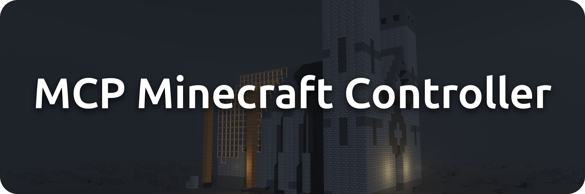

<div align="center">

<p align="center"><b>English</b> | <a href="README.ja.md">日本語</a></p>

<p align="center">
  
</p>

<h3 align="center">Let your AI build in Minecraft, over RCON, with no mod.</h3>

<p align="center">An MCP server that lets AI assistants (Claude, Codex, and any other MCP client) build and operate on a Minecraft Java server over RCON. No mod is required.</p>

<p align="center">
  <a href="https://github.com/Lapius7/mcp-minecraft-controller/releases"></a>
  <a href="https://github.com/Lapius7/mcp-minecraft-controller/actions/workflows/ci.yml"></a>
  <a href="LICENSE"></a>
  <a href="https://bun.sh"></a>
  <a href="https://modelcontextprotocol.io"></a>
  <a href="https://www.minecraft.net"></a>
  <a href="https://github.com/Lapius7/mcp-minecraft-controller/stargazers"></a>
  <a href="https://github.com/Lapius7/mcp-minecraft-controller/commits/main"></a>
</p>

<p align="center"><a href="#quick-start">Quick start</a> · <a href="#tools">Tools</a> · <a href="#safety">Safety</a> · <a href="#roadmap">Roadmap</a></p>

</div>

---

Ask for "a stone-brick tower next to Steve" or "a glass dome of radius 10 at the origin", and the AI turns it into server commands.


## Highlights

- Shapes: `fill`, sphere, cylinder, line, pyramid, arch, spiral stairs, roof, and walls with windows. Large areas are split automatically to stay under the `/fill` limit of 32768 blocks.
- Palettes: mix blocks by ratio with a `seed`, so a dry run and the real run match.
- Schematics and copy: paste `.schem` (Sponge v2/v3) and structure `.nbt` files, and copy regions with rotation and flips.
- Undo: `set_block`, `fill`, and `build_*` are backed up first and can be undone, newest first.
- Dry run: shows the command count, the most blocks that could change, and the bounding box before anything runs.
- Version checks: with a `version`, block names, renames, and build height are checked before writing.
- Multiple servers, optionally through an SSH tunnel.
- Command policy and an operation log: dangerous commands such as `stop`, `op`, and `ban` are refused by default.

### What is verified

The unit tests (`pnpm test`) run against a fake world, with no server.

> [!NOTE]
> The author has run it on one real setup only: a Paper server on Minecraft 26.3, including a cathedral of about 700 commands. Other server software and versions are not verified. Client-side actions such as camera, movement, and screenshots are out of scope.

## Quick start

You need [Bun](https://bun.sh), [pnpm](https://pnpm.io), and a Minecraft Java server with RCON enabled.

**1. Install**

```sh
git clone https://github.com/Lapius7/mcp-minecraft-controller
cd mcp-minecraft-controller
pnpm install
```

**2. Enable RCON** in `server.properties`, then restart the server.

```properties
enable-rcon=true
rcon.port=25575
rcon.password=use-a-long-random-password
```

**3. Register it with your AI client.** For Claude Code, run:

```sh
claude mcp add mc \
  -e MC_RCON_PASSWORD=use-a-long-random-password \
  -- bun run /absolute/path/to/mcp-minecraft-controller/src/index.ts
```

For Codex, add this to `~/.codex/config.toml`:

```toml
[mcp_servers.mc]
command = "bun"
args = ["run", "/absolute/path/to/mcp-minecraft-controller/src/index.ts"]
env = { MC_RCON_PASSWORD = "use-a-long-random-password" }
```

Any other MCP client works if it can launch `bun run src/index.ts` over stdio.

**4. Try it.** Start the server and ask the AI: "List the online players" or "Where is Steve standing?".

## Tools

<details>
<summary>All tools</summary>

| Tool | Description |
|---|---|
| `list_servers` | List the registered servers and the current default |
| `use_server` | Change the default server |
| `run_command` | Run one command and return its output. A leading `/` is optional |
| `run_commands` | Run up to 2000 commands in order |
| `get_player_pos` | Get a player's position, rotation, and dimension |
| `set_block` | Place one block |
| `fill` | Fill a box. `mode` is `replace`, `hollow`, `outline`, `keep`, or `destroy`. Large boxes are split automatically to stay under the 32768-block limit |
| `build_sphere` | Build a sphere (radius 1 to 60), optionally hollow |
| `build_cylinder` | Build a cylinder (radius 1 to 60, height 1 to 320), optionally hollow |
| `build_line` | Draw a 3D line between two points |
| `build_pyramid` | Square pyramid (optionally hollow) |
| `build_arch` | Semicircular arch with legs, thickness and depth |
| `build_spiral_stairs` | Spiral stairs around an optional center pillar (one block up per step) |
| `build_roof` | Gable or hip roof; `stairBlock` makes the gable slopes from facing stairs |
| `copy_region` | Copy a region to another place with 90° rotation and x/z flips (server-side `clone`; block facing is not rotated) |
| `paste_schematic` | Paste a `.schem` (Sponge v2/v3) or structure `.nbt` file at given coordinates (block entity NBT such as chest contents is not pasted) |
| `build_walls` | Four walls with evenly spaced windows and a door opening (air; no door block) |
| `undo` | Undo the latest writes (`steps` = how many). Newest first only |
| `list_history` | List the writes `undo` can restore, per server |
| `operation_log` | Show the latest log entries (runs, dry runs, refusals, failures, undos) |
| `inspect_region` | Count blocks by type in a region (read only) |

</details>

`set_block`, `fill`, and `build_*` take `dryRun: true`, which runs nothing and returns the command count, the most blocks that could change, and the bounding box.

> [!TIP]
> Run a large build with `dryRun: true` first to check its size and bounding box before anything is written.

Coordinates are absolute integers in the form `[x, y, z]`. Blocks accept block states, such as `oak_stairs[facing=north]`. Shape tools return a short summary (commands run, succeeded, sample failures) instead of dumping every response.

`run_command` can run any command the server console can, so the AI can also change the time, weather, game rules, and entities, give items, and teleport players.

## How an AI builds

1. It calls `get_player_pos` to find a base coordinate.
2. It picks shapes (`fill`, `build_sphere`, ...) and, for fine detail, sends many commands through `run_commands`.
3. It checks results with commands such as `execute if block x y z <block>`, which return "Test passed" or "Test failed".

## Multiple servers

Register several servers in `~/.config/mc-ai-connection/servers.json` (override the path with `MC_SERVERS_FILE`). See [`servers.example.json`](servers.example.json). Keep the file private (`chmod 600`).

<details>
<summary>Server fields</summary>

| Field | Description |
|---|---|
| `host`, `port` | RCON address. With `ssh`, this is seen from the SSH host |
| `password` / `passwordEnv` | The password, or the name of an environment variable that holds it |
| `ssh` | Optional. An SSH host from `~/.ssh/config`. The MCP opens a tunnel, so the RCON port never has to be exposed |
| `version` | Optional. The Minecraft version (for example `1.21.4`, `26.1`). Enables block-name and height checks and renames; see "Versions" below. For the single-server environment setup, use `MC_VERSION` |
| `description` | Free text shown by `list_servers` |
| `default` (top level) | The server used when a call has no `server` |

</details>

Every tool takes an optional `server` argument. `list_servers` shows what is registered, and `use_server` changes the default until the MCP restarts. Without the file, the `MC_RCON_*` variables below define a single server named `default`, as before. With the file, they are ignored.

## Environment variables

<details>
<summary>Environment variables</summary>

| Variable | Default | Description |
|---|---|---|
| `MC_RCON_HOST` | `127.0.0.1` | Server host |
| `MC_RCON_PORT` | `25575` | RCON port |
| `MC_RCON_PASSWORD` | empty | RCON password |
| `MC_MAX_VOLUME` | `200000` | Maximum number of blocks one operation may change |
| `MC_MAX_PALETTE_BLOCKS` | `30000` | Maximum number of blocks one operation may mix with a palette |
| `MC_MAX_COPY_COLUMNS` | `10000` | Maximum number of columns that `copy_region` may rotate or flip in one call |

</details>

## Settings file

Behavior settings live in `~/.config/mc-ai-connection/config.json` (override the path with `MC_CONFIG_FILE`). See [`config.example.json`](config.example.json). Every field is optional.

> [!NOTE]
> The directory is still named `mc-ai-connection`, after the project's old name. It is kept so that existing settings keep working.

<details>
<summary>Settings fields</summary>

| Field | Default | Description |
|---|---|---|
| `commands.deny` | `stop`, `op`, `deop`, `ban`, `ban-ip`, `pardon`, `pardon-ip` | Commands that are refused. Matched by prefix on words, so `"time set"` works. Set `[]` to allow everything |
| `commands.allow` | `[]` | If not empty, only commands matching an entry run. `deny` wins over `allow` |
| `log.enabled` | `true` | Write the operation log |
| `log.file` | `operations.jsonl` in `MC_STATE_DIR` | Where the log goes |
| `undo.enabled` | `true` | Save original blocks before each write so it can be undone |
| `undo.limit` | `20` | History entries kept per server. Older ones are dropped |
| `undo.origin` | `[29000000, 29000000]` | `[x, z]` of the backup area (see Undo). Keep it inside the world border |
| `undo.maxVolume` | `2000000` | Largest number of blocks one operation may back up |

</details>

The lists apply to the commands you or the AI ask for: `run_command`, `run_commands`, and the ones that `fill` and `build_*` generate, including the command after `run` in `execute ... run <command>`. The MCP's own internal commands (the `clone` and `forceload` that undo and `inspect_region` use, and the `data get` behind `get_player_pos`) are not checked, so a deny rule on `clone` does not break undo. The history lives in `MC_STATE_DIR` (default `~/.local/state/mc-ai-connection`).

## Versions

When a server has a `version`, the write tools (`set_block`, `fill`, `build_*`, `copy_region`, `paste_schematic`) check the commands before anything is written, and the dry run shows the same result:

- **Block names**: a name that does not exist in that version is rejected with a "did you mean" hint. The lists come from [minecraft-data](https://github.com/PrismarineJS/minecraft-data) for 1.16.5 through 26.1 (`bun scripts/gen-blocks.ts` regenerates `src/blocks.data.ts`). For a version between two listed ones (such as 1.21.2), a name is accepted if either neighbor has it. Versions older or newer than the list are not checked (a note says so). Names from other namespaces and `#tags` are not checked.
- **Renamed blocks** are translated to the name that version uses: `grass_path`/`dirt_path` (1.17), `grass`/`short_grass` (1.20.3), `chain`/`iron_chain` (1.21.9). This works in both directions.
- **Height**: 0 to 255 before 1.18, -64 to 319 from 1.18.

`run_command` and `run_commands` are not translated; their command text is sent as written. Without a `version`, nothing is checked. The version is not detected from the server, because RCON has no vanilla command for it.

## Block palettes

Where a tool takes `block` (`set_block`, `fill`, `build_sphere`, `build_cylinder`, `build_line`), you can pass a list instead of one name to mix blocks by ratio:

```json
{ "block": [{ "block": "stone_bricks", "weight": 70 }, { "block": "mossy_stone_bricks", "weight": 30 }], "seed": 1 }
```

`weight` is relative (it need not add up to 100). The same `seed` gives the same pattern, so a dry run and the real run match. A palette places blocks one by one (runs of the same block are merged into one `fill`), so it is capped by `MC_MAX_PALETTE_BLOCKS`. With `fill`, `mode` can be `replace`, `hollow`, or `outline`.

## Progress

For long operations (the write tools and `run_commands`), the server sends MCP `notifications/progress` while commands run, roughly every 5% or every second. A client only gets them if it sends a `progressToken` with the call; clients that do not are unaffected. The count is commands run, not blocks. The backup step before a write does not report progress.

## Operation log

Every call that runs or refuses commands is appended to `operations.jsonl` (one JSON object per line: time, server, tool, status, summary, command counts). By default it sits next to the undo history in `MC_STATE_DIR`, and each entry carries the history ID (`historyId`), so you can match a log line to an `undo` entry. The file is rotated to `operations.jsonl.1` at 5 MB.

## Undo

Before `set_block`, `fill`, and `build_*` write, the MCP copies the region to a backup area with `/clone`, so block states and block entities such as chest contents come back exactly. The backup area is far from the spawn (`undo.origin`) and its chunks are force-loaded only while an entry is kept. `undo` copies it back and clears the backup.

- History is per server and per operation. Entries can only be undone newest first, because restoring an old one under a newer overlapping build would corrupt the world.
- If the backup fails, nothing is written. If the restore fails, the entry is kept so you can retry.
- The region must be loaded, because `/clone` needs loaded chunks. Everything runs in the dimension RCON commands use (the overworld).
- `run_command` and `run_commands` are **not** covered. The MCP cannot know what an arbitrary command changes. Build the part you may want back with `fill` or `build_*`.
- Entities (mobs, dropped items) are not saved.

## Troubleshooting

**`Failed to connect`**

- The server is not running, or RCON is not enabled. Check that `enable-rcon=true` is set and the server was restarted.
- The host is wrong. If the server runs on Windows and the AI runs in WSL2, `127.0.0.1` may not reach it. Use the Windows host IP (the default gateway shown by `ip route show default`) as `MC_RCON_HOST`, or switch WSL to mirrored networking (`networkingMode=mirrored` in `.wslconfig`).

**Command syntax errors**

Command syntax changes between Minecraft versions. For example, in 26.x `time query daytime` no longer exists and you use `time query day`. Let the AI read the error and retry, or ask it to check the command with `run_command` first.

## Safety

> [!WARNING]
> RCON is unencrypted and has full control of the server. Never expose the RCON port to the internet. Use a strong password and a firewall.

> [!IMPORTANT]
> `stop`, `op`, `ban`, and similar commands are refused by default (see the settings file). Only connect to servers you own, and tighten `commands.allow` if the AI should do less.

> [!NOTE]
> `undo` covers `set_block`, `fill`, and `build_*` only. Back up the world before large builds, and before anything done through `run_command`. `MC_MAX_VOLUME` refuses oversized single operations.

Only server-side commands are available. Client-side actions such as camera, movement, and screenshots are out of scope.

## Development

```sh
pnpm check   # type check and unit tests (no server needed)
pnpm test    # unit tests only
pnpm start   # start the MCP server on stdio
```

<details>
<summary>Source files</summary>

| File | Role |
|---|---|
| `src/rcon.ts` | Minimal RCON client |
| `src/servers.ts` | Server registry, config file, SSH tunnels |
| `src/builders.ts` | Pure functions that turn shapes into command lists |
| `src/policy.ts` | Command allow list and deny list |
| `src/plan.ts` | Works out which blocks a command list changes |
| `src/history.ts` | Backup before writing, and undo |
| `src/ops.ts` | Shared flow for writes: policy, dry run, backup, run |
| `src/palette.ts` | Mix blocks by ratio |
| `src/copy.ts` | Copy/paste with rotation and flips as `clone` commands |
| `src/nbt.ts`, `src/schematic.ts` | Read `.schem` / `.nbt` into `fill` / `setblock` |
| `src/versions.ts`, `src/validate.ts` | Per-version block names, renames and height checks |
| `src/shapes.ts` | Pyramid, arch, spiral stairs, roof, walls with windows |
| `src/oplog.ts` | Operation log file |
| `src/inspect.ts` | Block counts for a region |
| `src/config.ts` | Settings file |
| `src/index.ts` | MCP tool definitions |

</details>

## Roadmap

- Translate command syntax differences for `run_command` (the write tools already handle block names, renames and heights)
- A companion MCP that reports a user's installed mods

## License

[MIT](LICENSE)
